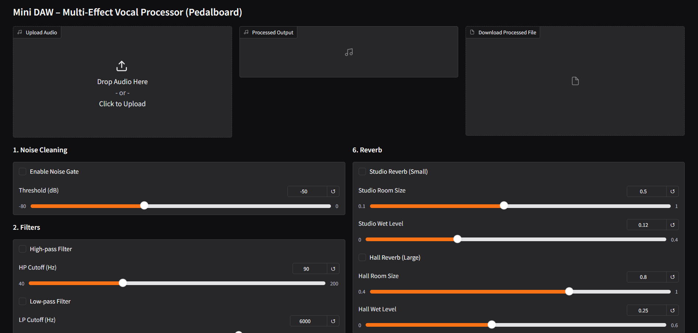
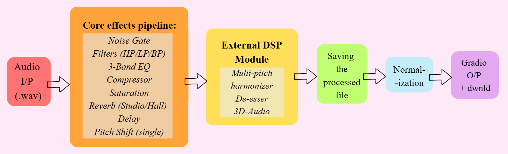
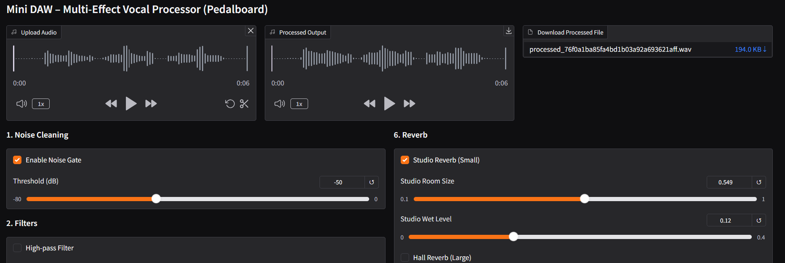
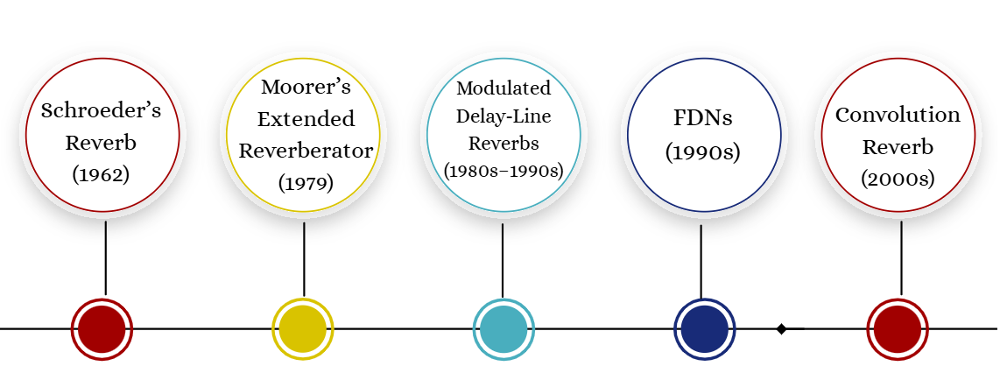
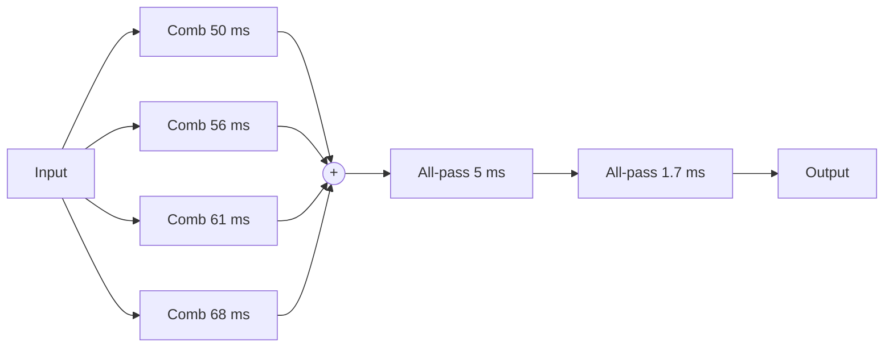
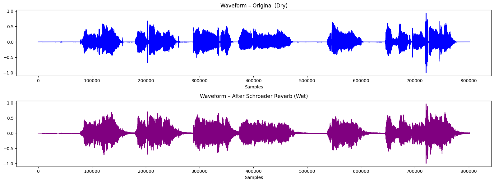
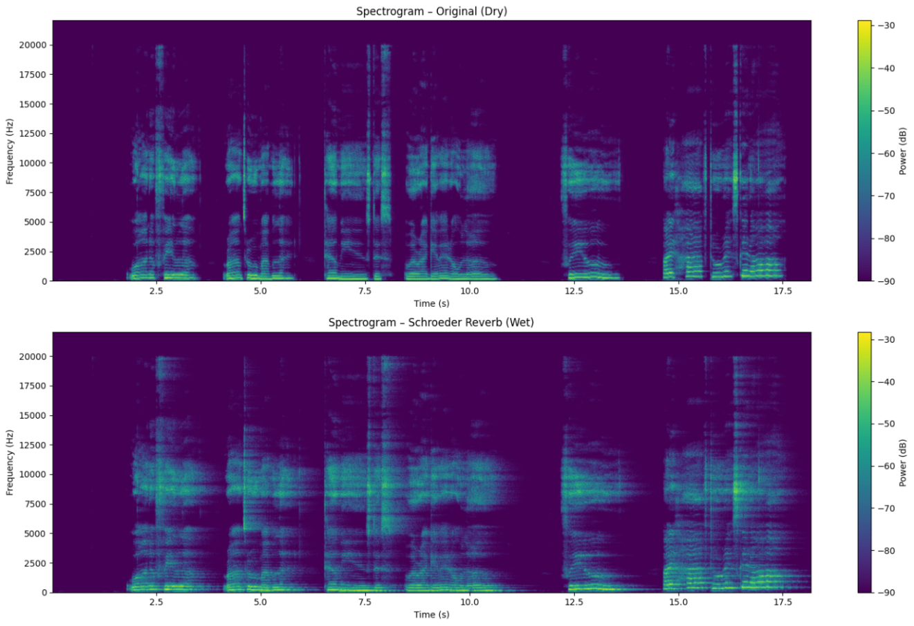

# Mini DAW: Multi-Effect Vocal Processor

A small **digital audio workstation (DAW)** that runs in the browser. Upload a vocal recording, switch effects on and off, adjust them with sliders, listen to the result and download it. It's built in Python with **Gradio** for the interface and Spotify's **Pedalboard** as the main audio engine. Several effects are also written by hand with NumPy and SciPy, including **Schroeder's 1962 reverberator**.

**Live demo:** https://mini-daw.onrender.com



## Features

The effects follow the order used in real mixing: **corrective** effects first (to clean up the raw recording), then **creative** effects (to add colour and space). Doing it the other way round would, for example, add reverb to background noise and then make it louder.

| # | Effect | What it does |
|---|---|---|
| 1 | Noise gate | Mutes quiet background noise between words |
| 2 | High-pass / low-pass / band-pass filters | Remove low rumble or high hiss |
| 3 | 3-band EQ | Cuts "mud" at 250 Hz, boosts presence at 3.5 kHz and "air" at 10 kHz |
| 4 | Compressor | Evens out loud and quiet parts |
| 5 | Saturation | Adds harmonics for a warmer, thicker sound |
| 6 | Reverb: studio, hall, and Schroeder | Adds the sound of a room; the Schroeder reverb is my own implementation |
| 7 | Delay / echo | Repeats the sound with adjustable time and feedback |
| 8 | Pitch shift and multi-pitch harmonizer | Shifts pitch, or layers octaves (0, ±12, +24 semitones) |
| 9 | De-esser | Turns down harsh "s" and "sh" sounds only while they happen |
| 10 | 8D audio (auto-pan) | Moves the sound smoothly between the left and right ears |

## How it works



1. The uploaded file is read with **SoundFile**.
2. The selected Pedalboard effects run as one chain (noise gate → filters → EQ → compressor → saturation → reverb → delay → pitch).
3. The hand-written effects in `dsp.py` run next: Schroeder reverb, harmonizer, de-esser and auto-pan.
4. The result is normalised so it can't clip, saved as WAV, and offered for playback and download.



## Schroeder reverb, implemented from scratch

Reverb is the dense pattern of echoes created when sound reflects off the walls of a room. Manfred Schroeder's 1962 paper *Natural Sounding Artificial Reverberation* showed how to fake it with a few simple digital filters, and his design is the starting point of most digital reverbs since.



My implementation (`schroeder_reverb` in `dsp.py`) follows the original structure:



- **Four feedback comb filters in parallel**, `y[n] = x[n] + g·y[n−D]`, each produce a decaying train of echoes. Their different delay times keep the echoes from lining up and sounding metallic.
- **Two all-pass filters in series**, `y[n] = −g·x[n] + x[n−D] + g·y[n−D]`, multiply the number of echoes so the tail sounds smooth, without changing the overall tone.

The filters are written as difference equations and run with `scipy.signal.lfilter`, which gives exactly the same output as a sample-by-sample loop but much faster.

The waveform shows the tail that reverb adds after each word, and the spectrogram shows sound energy fading out slowly instead of stopping sharply:




To make these plots for your own recording:

```bash
python schroeder_demo.py your_recording.wav
```

## Project files

| File | What it is |
|---|---|
| `app.py` | The Gradio app and the main effects chain |
| `dsp.py` | Hand-written effects: Schroeder reverb, harmonizer, de-esser, auto-pan |
| `schroeder_demo.py` | Applies the Schroeder reverb to a file and saves waveform and spectrogram plots |
| `requirements.txt` | Python packages needed |

## Run it locally

```bash
pip install -r requirements.txt
python app.py
```

Then open http://localhost:7860 in your browser.

## Limitations

- Processing happens after you press **Process**, not in real time while audio plays.
- No waveform editing, multiple tracks, or microphone recording.
- Clips are limited to 2 minutes, to keep processing quick on free hosting.

## References

1. U. Zölzer (ed.), *DAFX: Digital Audio Effects*, 2nd ed., Wiley, 2011.
2. M. R. Schroeder, "Natural Sounding Artificial Reverberation," Bell Telephone Laboratories, 1962.
3. J. O. Smith, *Physical Audio Signal Processing*, CCRMA, Stanford, 2010. https://ccrma.stanford.edu/~jos/pasp/
4. Spotify Pedalboard. https://github.com/spotify/pedalboard

## Built with

Python, Gradio, Pedalboard, NumPy, SciPy, SoundFile, Matplotlib
